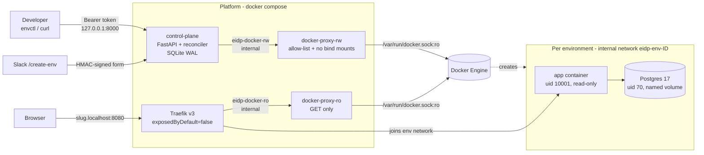
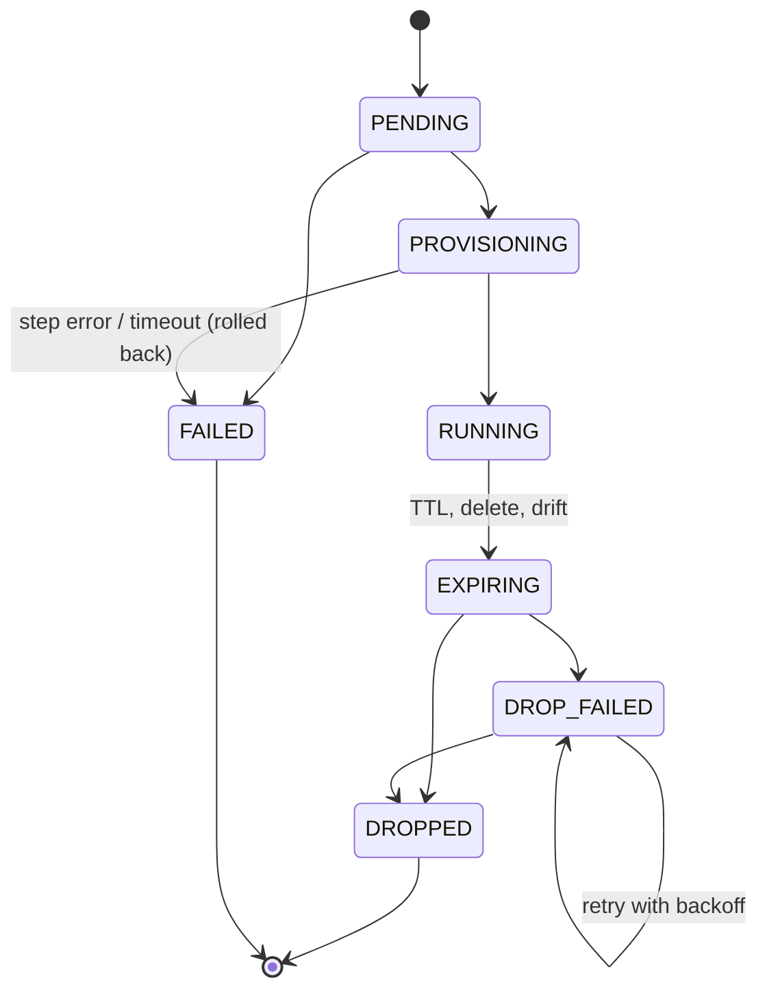

# self-service-ephemeral-envs

[](https://github.com/Nova20004/self-service/actions/workflows/ci.yml)
[](LICENSE)
%20%7C%203.9%2B%20(CLI)-informational)


A small, free, laptop-sized **internal developer platform**: one command gives a
developer an isolated, TTL-bound preview environment (app + Postgres) for a
branch, routed at `http://<slug>.localhost:8080`, created from a CLI, a REST API
or a signed Slack slash command, and reaped automatically when its time is up.

<!-- asciinema: replace with the real recording once published -->
[-lightgrey)](#try-it)

## Why

Shared staging environments are a queue. Per-branch preview environments remove
the queue, but in most teams they cost a Kubernetes cluster, a cloud bill and a
platform team. This project shows the same developer experience - **self-service,
guard-railed, observable, and cleaned up by default** - with nothing but Docker:

- **Self-service**: `envctl create feature/login` or `/create-env feature/login` in Slack.
- **Guard rails**: TTLs, per-owner and global quotas, a memory budget, hard
  lifetime deadlines, hardened containers and a filtered Docker API.
- **Leak-proof**: a reconciliation loop drops expired environments, repairs drift,
  retries failed teardowns with backoff and removes orphans after a grace period.
- **FinOps-aware**: every environment has a memory size and an estimated hourly
  cost; Prometheus metrics and an admin summary make spend visible.

## Quickstart

Requirements: Docker Engine / Docker Desktop with Compose v2, Python >= 3.9, `curl`,
GNU Make (`gmake` on macOS via Homebrew; macOS `/usr/bin/make` 3.81 is also supported).

```bash
gmake doctor   # checks Docker, Compose v2, ports 8000/8080, Python, socket permissions
gmake env      # writes .env with fresh random tokens (never overwrites an existing one)
gmake demo     # builds images, starts the stack and runs the 14-step lifecycle demo
```

`gmake down` stops everything and removes every resource labelled
`managed-by=ephemeral-idp`. `gmake help` lists all targets.

## Try it

```bash
gmake up                                     # platform without the demo overlay
export ENVCTL_TOKEN=$(grep ^OWNER_TOKENS .env | cut -d= -f2 | tr ',' '\n' | sed -n 's/^alice://p')

./cli/envctl create feature/login --ttl 2h --wait   # prints URL + DSN (password shown once)
curl -H 'Host: feature-login.localhost' http://127.0.0.1:8080/
./cli/envctl list
./cli/envctl extend feature-login --by 1h
./cli/envctl psql feature-login              # docker exec into the env database
./cli/envctl delete feature-login --wait

# Signed Slack slash command, without a Slack workspace:
python3 scripts/sign-slack-request.py --send --text "feature/payments ttl=30m"
python3 scripts/sign-slack-request.py --send --tamper   # -> 401
```

`envctl` exit codes: `0` ok, `1` error, `2` usage, `3` quota exceeded (429), `4` auth (401/403).

## Architecture



Each environment gets its own **internal** bridge network (no egress, no host
ports). Traefik is connected to that network only while the environment is
routed. Details, sequence and state diagrams: [docs/ARCHITECTURE.md](docs/ARCHITECTURE.md).



## API

All errors are `application/problem+json` ([RFC 9457](https://www.rfc-editor.org/rfc/rfc9457))
with a stable `type` (`urn:ephemeral-idp:problem:<code>`). Authenticate with
`Authorization: Bearer <token>`; owners see their own environments, the admin sees all.

| Method | Path | Who | Success | Notable errors |
|---|---|---|---|---|
| GET | `/healthz` | anyone | 200 | - |
| GET | `/readyz` | anyone | 200 (database + Docker proxy) | 503 |
| GET | `/metrics` | anyone (bound to 127.0.0.1) | 200 Prometheus text | - |
| POST | `/v1/envs` `{"branch","ttl"}` | owner | 202 + URL + one-time DSN | 400, 401, 409 slug live, 429 quota (`Retry-After`) |
| GET | `/v1/envs[?all=true]` | owner / admin | 200 | 401 |
| GET | `/v1/envs/{slug}` | owner / admin | 200 | 401, 403, 404 |
| POST | `/v1/envs/{slug}/extend` `{"by":"1h"}` | owner / admin | 200 (`capped_at_hard_deadline`) | 400, 403, 404, 409 not RUNNING / lifetime exhausted |
| DELETE | `/v1/envs/{slug}` | owner / admin | 202 (idempotent) | 403, 404, 409 still provisioning |
| GET | `/v1/audit?limit=` | admin | 200 | 401, 403 |
| GET | `/v1/finops/summary` | admin | 200 | 401, 403 |
| POST | `/v1/chatops/create-env` | Slack signature | 200 ephemeral message | 401 bad/stale/replayed signature |

## Configuration

`gmake env` writes `.env` (gitignored, mode 600). Placeholders live in `.env.example`.

| Variable | Default | Meaning |
|---|---|---|
| `ADMIN_TOKEN` | generated | admin bearer token (>= 16 chars) |
| `OWNER_TOKENS` | generated `alice:…,bob:…` | owner bearer tokens |
| `SLACK_SIGNING_SECRET` | generated | HMAC key for `/v1/chatops/create-env` |
| `API_PORT` / `EDGE_PORT` | `8000` / `8080` | loopback ports for API and Traefik |
| `DOCKER_SOCKET_GID` | `0` (macOS) / socket gid (Linux) | group the socket proxies run as |
| `BASE_DOMAIN` | `localhost` | env URL is `http://<slug>.<BASE_DOMAIN>:<EDGE_PORT>` |
| `MIN_TTL_SECONDS` / `MAX_TTL_HOURS` | `60` / `48` | accepted TTL range |
| `MAX_TOTAL_LIFETIME_HOURS` | `72` | hard deadline, extensions included |
| `MAX_ENVS_PER_OWNER` / `MAX_ENVS_TOTAL` | `3` / `10` | live-environment quotas |
| `MAX_TOTAL_MEMORY_MB` | `1024` | sum of env memory caps across live envs |
| `COST_PER_GB_HOUR` | `0.01` | unit price for cost estimates |
| `RECONCILE_INTERVAL_SECONDS` | `3` | reconciler period |
| `PROVISION_TIMEOUT_SECONDS` | `120` | stuck-provisioning timeout |
| `ORPHAN_GRACE_SECONDS` | `60` | age before an unknown labelled resource is removed |

## FinOps and TTL

- Every environment is `app 64 MB + db 128 MB = 192 MB`; estimated cost =
  `192/1024 × COST_PER_GB_HOUR` per hour (0.001875 units/h by default).
- TTL defaults to 24h, accepts `s|m|h|d`, is bounded by `MIN_TTL_SECONDS` and
  `MAX_TTL_HOURS`; `extend` is capped at the hard deadline (`created_at + 72h`).
- Quotas are checked inside the same SQLite `BEGIN IMMEDIATE` transaction as the
  reservation, so concurrent requests cannot overshoot.
- Metrics (no per-slug labels, bounded cardinality): `ephemeral_envs_active{status}`,
  `ephemeral_envs_created_total`, `ephemeral_envs_reaped_total`,
  `ephemeral_quota_rejections_total{reason}`, `ephemeral_provision_failures_total`,
  `ephemeral_orphans_reaped_total`, `ephemeral_teardown_giveups_total`,
  `ephemeral_cost_units_total`, `ephemeral_provision_duration_seconds`,
  `ephemeral_reconcile_duration_seconds`. Counters reset when the control plane
  restarts (standard Prometheus semantics); durable history is the audit log.

## Security

Summary - the full analysis is in [docs/THREAT-MODEL.md](docs/THREAT-MODEL.md).

- No container is privileged, uses the host network/PID namespace or a host bind mount.
  The only bind mount is `/var/run/docker.sock`, read-only, in the two socket proxies.
- The control plane talks to Docker through `docker-proxy-rw`, an allow-list of
  the exact endpoints it uses, which also **rejects any bind mount** in
  `containers/create`; Traefik uses a separate GET-only proxy.
- All containers: `cap_drop: ALL`, `no-new-privileges`, read-only root FS, non-root
  user, memory = memory+swap cap, PID limit, `restart: no` for envs.
- Tokens are compared in constant time against SHA-256 digests; Slack requests are
  verified with HMAC-SHA256, a 5-minute window and a replay cache.
- The audit table is append-only (SQLite triggers abort `UPDATE`/`DELETE`).
- Images are pinned by digest, Actions by commit SHA, Python deps by exact version;
  CI runs Trivy (0 CRITICAL, documented exceptions with expiry in `.trivyignore.yaml`).

## Measured resources

Measured on macOS (Docker Desktop, arm64) with `docker stats --no-stream`, platform
plus one idle RUNNING environment:

| Container | Used | Cap |
|---|---|---|
| control-plane | 48.1 MiB | 96 MiB |
| traefik | 48.8 MiB | 64 MiB |
| docker-proxy-rw | 11.1 MiB | 32 MiB |
| docker-proxy-ro | 11.4 MiB | 32 MiB |
| env app | 25.4 MiB | 64 MiB |
| env Postgres | 15.8 MiB | 128 MiB |
| **Total** | **≈ 161 MiB** | **416 MiB** |

`docker stats` counts active page cache. Traefik's figure is about 30 MiB of
process memory plus about 23 MiB of its 160 MB binary held in cache; in other
runs it read 26 MiB once that cache was cold. Its cgroup recorded no
`memory.max` events during the measurement.

## Platform support

| Platform | Status |
|---|---|
| macOS (Docker Desktop) | tested locally (`gmake doctor && gmake env && gmake demo`) |
| Linux (Ubuntu, Docker Engine) | tested in CI (`e2e` job) |
| Windows / WSL2 | not tested |

**Docker socket permissions.** On Docker Desktop the socket inside the VM is
owned by root, so the proxies run as `65534:0`. On Linux it belongs to the
`docker` group; `gmake env` records `stat -c %g /var/run/docker.sock` as
`DOCKER_SOCKET_GID` and the proxies run as `65534:<gid>`.

**`*.localhost`.** Browsers resolve any `*.localhost` name to loopback (RFC 6761),
so `http://feature-login.localhost:8080` opens directly. Outside browsers:
on macOS the system resolver returned `127.0.0.1` for `foo.localhost` in our test
(macOS 26, `socket.gethostbyname`); on Linux it depends on the NSS setup
(`systemd-resolved` or `nss-myhostname` resolve it, plain `/etc/hosts` does not).
The portable form is `curl -H 'Host: <slug>.localhost' http://127.0.0.1:8080/`,
which the demo and CI use.

## Troubleshooting

| Symptom | Fix |
|---|---|
| `gmake doctor` says port in use | set `API_PORT` / `EDGE_PORT` in `.env` |
| `readyz` reports `docker: false` on Linux | `DOCKER_SOCKET_GID` must match `stat -c %g /var/run/docker.sock`; delete `.env` only if you accept new tokens, or edit the value |
| `required variable ... run make env first` | run `gmake env` |
| tokens from `.env` get 401 / Slack demo step fails | a shell that exported `ADMIN_TOKEN`, `OWNER_TOKENS` or `SLACK_SIGNING_SECRET` overrides `.env` (Compose precedence); `gmake doctor` warns, `unset` them and `gmake down up` |
| environment stuck in `PROVISIONING` | it is failed and rolled back after `PROVISION_TIMEOUT_SECONDS`; see `gmake logs` |
| `DROP_FAILED` | teardown retried with exponential backoff (max 60 s); after `TEARDOWN_MAX_ATTEMPTS` it stays visible and `DELETE` re-arms it |
| leftover containers after a crash | `gmake down` removes everything labelled `managed-by=ephemeral-idp` |
| Traefik logs `aliasHeadersStrategy is not configured` | informational warning from Traefik 3.7; no forwarded-header aliasing is used here |
| a container is `unhealthy` but its logs look fine | check `memory.events` in its cgroup: a healthcheck that execs a large binary inside a small memory cap thrashes the page cache (why Traefik's healthcheck uses busybox `wget` on `/ping` rather than `traefik healthcheck`) |
| `make test` asks for Python 3.13 | `gmake test PYTHON=python3.13` (only the CLI needs to run on 3.9) |

## Development

```bash
gmake test       # 193 unit tests, coverage gate 85 % (currently ~96 %)
gmake validate   # compose config, yamllint --strict, ruff, mypy --strict, hadolint, shellcheck
cd control-plane && ../.venv/bin/python -m pytest -m integration --no-cov   # against a running stack
```

See [CONTRIBUTING.md](CONTRIBUTING.md), [SECURITY.md](SECURITY.md),
[docs/VERSIONS.md](docs/VERSIONS.md) and the ADRs in [docs/adr](docs/adr).

## Limitations

- Single host, single control-plane replica; SQLite is the source of truth.
- HTTP only, on loopback. No TLS, no SSO: static bearer tokens.
- The Docker proxy filters methods and paths, plus bind mounts; it cannot inspect
  every field of a `containers/create` body (see the threat model).
- Workload image is a fixed template; there is no build-from-branch step.

## Roadmap

- Scale-to-zero of idle environments (wake on first request).
- Kubernetes runtime (namespace per env) behind the same `Runtime` protocol.
- OIDC login instead of static tokens.
- Packaged Slack app (manifest, OAuth install, interactive messages).
- Multi-replica control plane (Postgres + leader election for the reconciler).
- HTTPS with a local CA or ACME on a real domain.

## License

[MIT](LICENSE)
