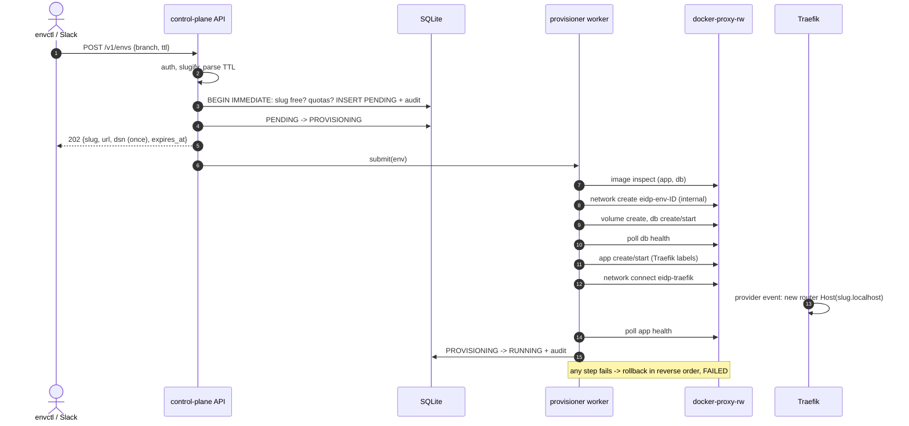
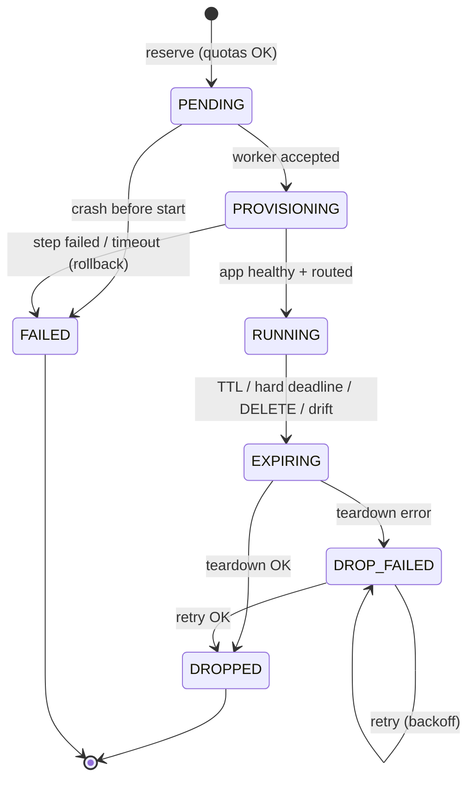

# Architecture

## Components

| Component | Image | Networks | Role |
|---|---|---|---|
| `control-plane` | `ephemeral-idp/control-plane:0.1.0` (python 3.13 slim) | `eidp-api`, `eidp-docker-rw` | FastAPI API, Slack endpoint, provisioner workers, reconciler, SQLite state on volume `eidp-state` |
| `docker-proxy-rw` | `wollomatic/socket-proxy:1.13.2` | `eidp-docker-rw` (internal) | allow-listed Docker API for the control plane only; rejects bind mounts |
| `docker-proxy-ro` | `wollomatic/socket-proxy:1.13.2` | `eidp-docker-ro` (internal) | GET-only Docker API for Traefik's provider |
| `traefik` | `ephemeral-idp/traefik:0.1.0` (Traefik v3.7.17, baked config) | `eidp-edge`, `eidp-docker-ro`, + each env network | routes `Host(<slug>.localhost)` to env apps |
| env `app` | `ephemeral-idp/workload:0.1.0` | `eidp-env-<id>` (internal) | sample workload, shows DB connectivity |
| env `db` | `ephemeral-idp/postgres:17.11-alpine-p1` | `eidp-env-<id>` (internal) | Postgres with a per-env named volume |

Only two ports are published, both on `127.0.0.1`: the API (`API_PORT`) and the
Traefik entrypoint (`EDGE_PORT`).

## Code layout (`control-plane/app`)

- `config.py` - immutable `Settings` from environment variables, validated at start.
- `models.py` - `Status`, the transition table, `Environment`, injectable `Clock`.
- `store.py` - SQLite (WAL, `BEGIN IMMEDIATE`), partial unique index on live slugs,
  quotas checked inside the reservation transaction, append-only audit triggers.
- `runtime.py` - `Runtime` protocol; `DockerRuntime` (httpx to the proxy) and
  `FakeRuntime` (fault injection for tests).
- `provisioner.py` - ordered provisioning steps with rollback; teardown.
- `reconciler.py` - periodic loop: expiry, stuck provisioning, drift, teardown
  retries, orphans, cost accounting.
- `auth.py`, `slack.py`, `quota.py`, `ttl.py`, `slug.py`, `metrics.py`, `api_errors.py`.
- `main.py` - FastAPI app factory and routes.

## Create sequence

## Reconciler pass

Each pass (default every 3 s, immediately at start-up) runs, in order:

1. **Expire** - `RUNNING` past `expires_at` (or the hard deadline) -> `EXPIRING`.
2. **Stuck provisioning** - `PENDING`/`PROVISIONING` not owned by a live worker
   (after a crash) or older than `PROVISION_TIMEOUT_SECONDS` -> rollback, `FAILED`.
3. **Drift** - `RUNNING` env whose app or db container is missing or not running -> `EXPIRING`.
4. **Teardown** - `EXPIRING` and due `DROP_FAILED`: remove app, db, Traefik
   attachment, network, volume (404-tolerant, so idempotent). Failure ->
   `DROP_FAILED` with backoff `min(2 * 2^(n-1), 60)` s; gives up after
   `TEARDOWN_MAX_ATTEMPTS` (metric `teardown_giveups_total`).
5. **Orphans** - labelled resources whose env id is unknown or terminal and older
   than `ORPHAN_GRACE_SECONDS` are removed (container, then network, then volume).
6. **Account** - adds `memory_gb × elapsed hours × price` to `cost_units_total`.

## State machine

Transitions are enforced in `models.TRANSITIONS`; every transition writes an
audit row in the same transaction. `DROPPED` and `FAILED` free the slug (the
unique index only covers live rows), so a branch can be recreated.

## Routing is eventually consistent

Traefik learns about containers from Docker events and applies changes after a
short throttle. For a few seconds after an environment reaches `RUNNING` its
URL may still return 404, and right after `DROPPED` a request may hang until
the stale router disappears; then it returns 404. The demo and the integration
tests poll for the expected status instead of assuming instant convergence.

## Persistence and restart

SQLite lives on the named volume `eidp-state`. On restart the reconciler runs
immediately: environments that were mid-provisioning are failed and rolled back,
expired ones are dropped, and containers left without a record are reaped as
orphans. The demo restarts the control plane and checks all three behaviours.

## Docker API surface

`docker-proxy-rw` allows exactly (method, path regex - the proxy anchors them):

- `GET`: `_ping`, `version`, `containers/json`, `containers/<id>/json`,
  `containers/<id>/logs`, `networks`, `networks/<id>`, `volumes`, `images/<ref>/json`
  (`HEAD _ping` too)
- `POST`: `containers/create`, `containers/<id>/{start,stop,kill}`,
  `networks/create`, `networks/<id>/{connect,disconnect}`, `volumes/create`
- `DELETE`: `containers/<id>`, `networks/<id>`, `volumes/<id>`
- plus `-allowbindmountfrom` set to a non-existent directory, so any bind mount is refused.

Everything else (exec, build, image pull, `info`, swarm, plugins…) returns 403.
`docker-proxy-ro` allows only `GET` on `_ping`, `version`, `events`,
`containers/json`, `containers/<id>/json`, `networks`, `networks/<id>` (and
`HEAD _ping`) - what Traefik's provider reads - and only from the `traefik` hostname.
