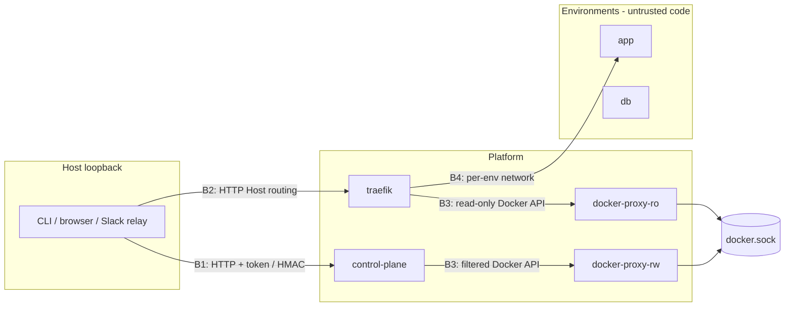

# Threat model

Scope: a single developer machine or CI runner running the stack with
`docker compose`. Method: STRIDE over the trust boundaries below. The platform
is a local/internal tool; it is **not** designed to be exposed to the internet.

## Assets

1. The Docker daemon (root-equivalent on the host).
2. Bearer tokens, the Slack signing secret, per-environment database passwords.
3. Environment data (Postgres volumes) and the state/audit database.
4. Host resources (memory, PIDs, disk) shared by all environments.

## Trust boundaries

## STRIDE

| # | Threat | Boundary | Mitigation | Residual |
|---|---|---|---|---|
| S1 | Forged owner/admin identity | B1 | random 192-bit tokens from `openssl rand`, stored as SHA-256, `hmac.compare_digest` over all entries; 401 + `WWW-Authenticate` | static tokens, no rotation API (roadmap: OIDC) |
| S2 | Forged or replayed Slack command | B1 | HMAC-SHA256 `v0:{ts}:{body}`, ±5 min window, in-memory replay cache | replay cache is per process (lost on restart, window still applies) |
| T1 | Tampering with the audit trail | state DB | SQLite triggers abort `UPDATE`/`DELETE` on `audit`; DB only on a named volume, not on the host | anyone with Docker access can still replace the volume |
| T2 | Owner acting on another owner's env | B1 | ownership check on every read/write; 403 (tested) | - |
| R1 | Repudiation of actions | B1 | every transition and request writes `actor` + action to the append-only audit | - |
| I1 | DSN password disclosure | B1 | returned once at creation, never stored or logged; DB reachable only on the env's internal network | visible in `docker inspect` to whoever controls Docker |
| I2 | Cross-environment access | B4 | one **internal** network per env; Traefik joins only routed envs; no published ports | Traefik is on every routed env network (by design) |
| I3 | Secrets in git | repo | `.env` gitignored and generated; `.env.example` placeholders; Trivy secret scan in CI | - |
| D1 | Resource exhaustion by many envs | B1 | per-owner (3), global (10) and memory (1024 MB) quotas checked transactionally; TTL and 72 h hard deadline; 429 + `Retry-After` | a single host is still a single host |
| D2 | Runaway env container | B4 | memory = memory+swap cap, CPU quota, PID limit, read-only rootfs + tmpfs, `restart: no` | disk usage of Postgres volumes is not capped |
| D3 | Leaked resources | B3 | reconciler: drift, retries with backoff, orphan reaping; `gmake down` removes all labelled resources | give-up after N attempts leaves a visible `DROP_FAILED` |
| E1 | Container escape / privilege escalation | B4 | `cap_drop: ALL`, `no-new-privileges`, non-root users (10001, 70, 65534), no privileged, no host PID/network, no host bind mounts | kernel/runtime vulnerabilities |
| E2 | Docker API abuse via the control plane | B3 | `docker-proxy-rw` allow-list (no exec, build, pull, info, swarm, plugins), `-allowfrom=control-plane`, bind mounts rejected, internal network | see "proxy limits" |
| E3 | Traefik compromise reaching Docker | B3 | Traefik only reaches `docker-proxy-ro` (GET/HEAD allow-list, `-allowfrom=traefik`); no dashboard/API enabled | read access to container metadata (incl. env vars) |

## Socket proxy limits (important)

The proxy filters **method + path**, the source hostname, and bind mounts in
`containers/create`. It does **not** validate the rest of the JSON body. A
compromised control plane could therefore still ask for a container with, for
example, `Privileged: true`, `CapAdd`, `PidMode: host`, `NetworkMode: host` or
a large memory limit. Defence for that case relies on the control plane itself
(fixed `ContainerSpec` built in code, no user-controlled fields except a
validated slug and TTL) and on the control plane running non-root, read-only,
capability-free. A body-validating proxy (or rootless Docker / a VM per env)
is the next step if the control plane must be treated as untrusted.

The integration tests prove the denials that the proxy does enforce: `GET /info`,
`POST /images/create`, `POST /containers/<id>/exec`, `POST /build` and a
`containers/create` with `Binds: ["/etc:/host-etc:ro"]` all return 403.

## Postgres without capabilities

The official Postgres entrypoint starts as root and uses `gosu` to drop to
uid 70, which needs `CHOWN`, `SETUID`, `SETGID`, `DAC_OVERRIDE` and `FOWNER`.
Running the container **directly as `70:70`** with a volume that Docker
initialises from the image (owned by 70) removes that need: we observed the
database initialising and serving with `cap_drop: ALL` and a read-only root FS
(`/var/run/postgresql` and `/tmp` on tmpfs). The derived image also deletes the
`gosu` binary, which removed a CRITICAL Go-stdlib finding from Trivy.

## Out of scope

Internet exposure, TLS, multi-tenant hostile users on the same host, supply-chain
compromise of upstream images beyond digest pinning and Trivy scanning, and host
hardening (keep Docker and the kernel patched).
